# Actuated Metamaterial — Magnetorheological-Fluid Beam with a Deep-Learning Digital Shadow

<p align="center">
  <b>Mechanical Engineering Applications of Deep Learning (063123) · Politecnico di Milano · A.Y. 2025/26</b>
  School of Industrial and Information Engineering, M.Sc. Mechanical Engineering
</p>

<p align="center">
  <i>Pietro Maria Ghisi · Andrea Ghisolfi · Erwin Rafael Novicio</i>
</p>

<p align="center">
  
  
  
  
  
</p>

<p align="center">
  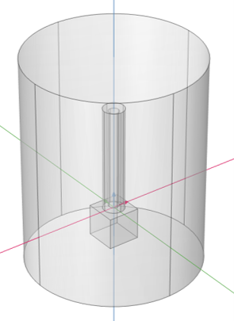
  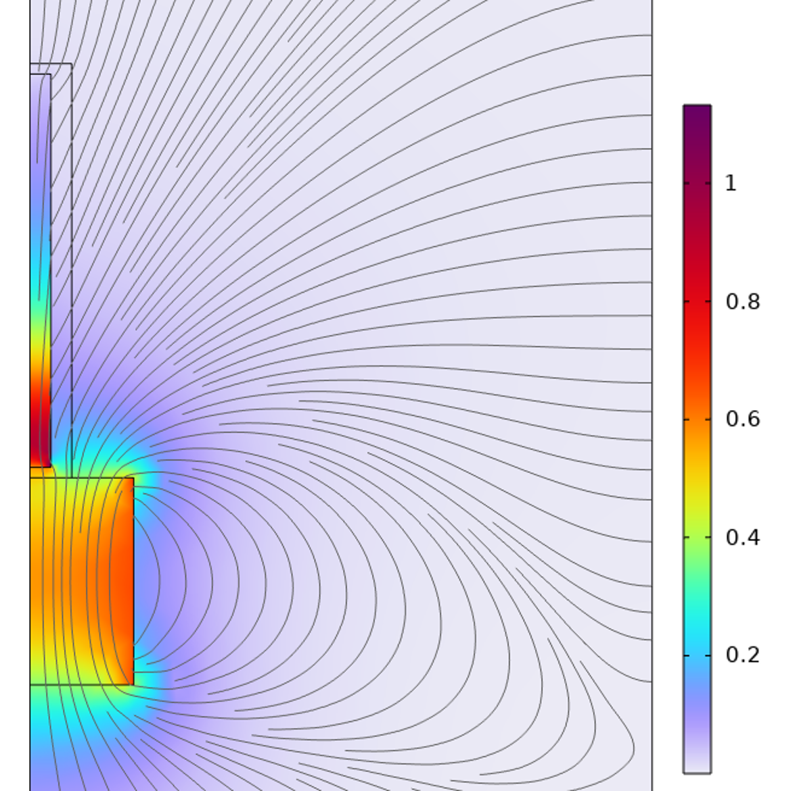
  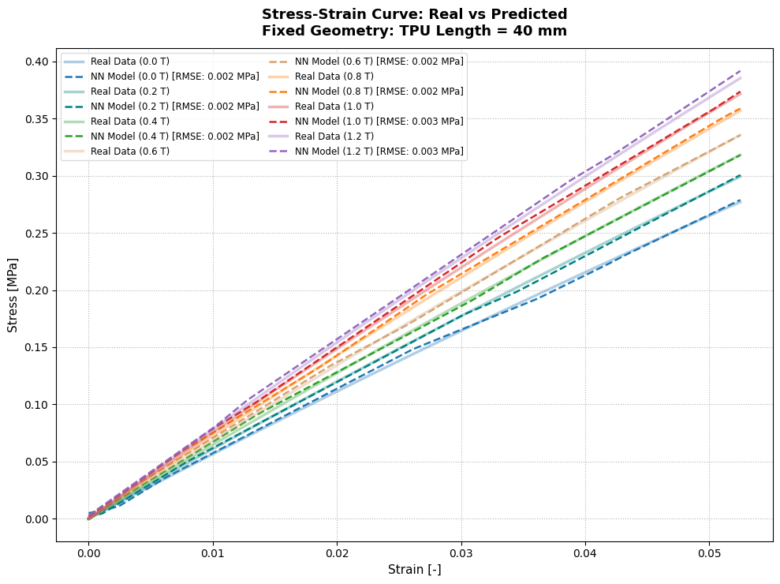
</p>

---

## TL;DR

We designed a **magnetically tunable mechanical metamaterial**: a hollow **TPU** (thermoplastic polyurethane) beam filled with a **magnetorheological fluid (MRF)** and placed on top of a **permanent magnet**. The magnet's field lines up the ferromagnetic particles in the fluid, which stiffens the core, so **the beam's stiffness can be controlled without touching it**.

The project covers the whole chain:

1. **Constitutive modelling** of the MRF from vendor datasheet curves, giving a field-dependent equivalent Young's modulus $`E_{eq}(H)`$.
2. **Analytical sizing** of the beam against Euler buckling, so it stays linear-elastic.
3. **Multiphysics FEM** in COMSOL, built up step by step from pure solid mechanics to full magneto-mechanical coupling with a non-linear $`B\text{–}H`$ curve.
4. **Dataset generation** from about 400 parametric FEM simulations.
5. **A family of MLP surrogates (a "digital shadow")** that reproduces the beam's behaviour with no further FEM:
   - **Direct model:** $`\sigma = f(B, L, \varepsilon)`$, with $`R^2 = 1.000`$ and RMSE ≈ 3.4·10⁻³ on the test set
   - **Inverse model:** $`L = f(B, \log\bar K)`$, with $`R^2 = 0.999`$ and relative error < 1.25 %
   - **Field networks:** $`B(x)`$, $`H(x)`$ and the strain-induced change $`\Delta H(x)`$, chained into one pipeline

---

## Table of Contents

1. [Motivation](#1-motivation)
2. [Overall Workflow](#2-overall-workflow)
3. [Magnetorheological Fluid Model](#3-magnetorheological-fluid-model)
4. [TPU Material](#4-thermoplastic-polyurethane-tpu)
5. [Beam Design & Buckling Analysis](#5-beam-design--buckling-analysis)
6. [Multiphysics Simulation Setup](#6-multiphysics-simulation-setup-comsol)
7. [Simulation Results](#7-simulation-results)
8. [Machine-Learning Digital Shadow](#8-machine-learning-digital-shadow)
9. [Results Summary](#9-results-summary)
10. [Limitations & Future Work](#10-limitations--future-work)
11. [References](#11-references)

---

## 1. Motivation

A **metamaterial**'s mechanical response comes from its internal geometry more than from its bulk material. Adding an **active phase** turns a fixed response into one you can tune. Magnetorheological fluids work well as that phase: they are suspensions of micrometre-sized ferromagnetic particles in a non-magnetic carrier liquid, and under a magnetic field the particles form chains along the field lines within milliseconds, which raises the fluid's apparent stiffness and yield stress.

Exploring this design space with high-fidelity FEM is expensive, because every geometry–field combination needs a fully coupled magneto-mechanical simulation. The second goal of the project was therefore to train **neural-network surrogates** that act as a *digital shadow* of the metamaterial: they predict its response in milliseconds and also solve the **inverse design** problem.

---

## 2. Overall Workflow

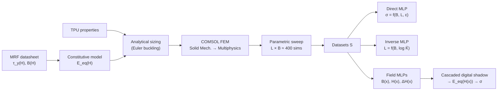

---

## 3. Magnetorheological Fluid Model

**Fluid selected:** *AMT-RHEOTEC+* by Arus MR Tech, a silicone-based MRF [4].

The two datasheet curves that matter for the mechanical model were digitised and fitted with polynomials:

| Yield shear stress $`\tau_y(H)`$ | Magnetisation curve $`B(H)`$ |
|:---:|:---:|
| 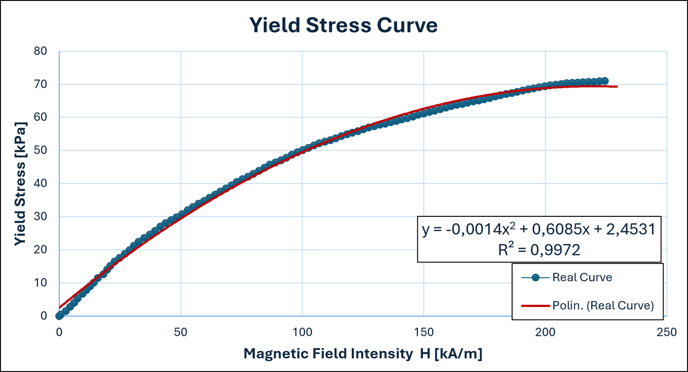 | 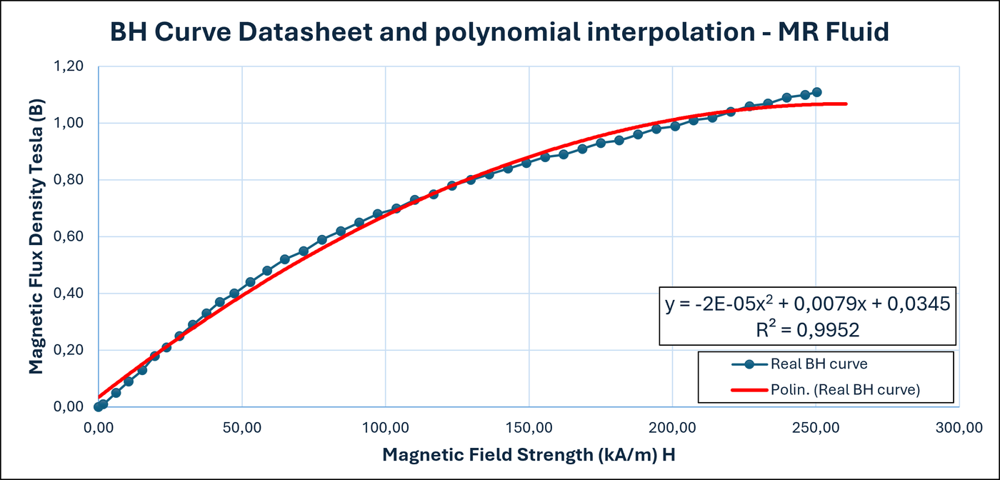 |
| Datasheet (blue) and quadratic fit (red), $`R^2 = 0.997`$ | Datasheet (blue) and quadratic fit (red), $`R^2 = 0.995`$ |

### 3.1 From yield stress to an equivalent Young's modulus

The literature [2] identifies three deformation regions for MRFs under squeeze: (I) linear, (II) constant compressive stress, and (III) non-linear. We work in **region I** under a **quasi-static** assumption, where the Bingham model applies and the viscous term can be neglected.

An experimental relation [2] links the compressive yield stress to the flux density:

```math
\sigma_{c,y}(H) = k\,B(H) + \sigma_{min}
```

This gives a first estimate of the equivalent modulus:

```math
E_{eq}(H) = \frac{\sigma_{c,y}(H)}{\epsilon_{c,y}} = \frac{k\,B(H) + \sigma_{min}}{\epsilon_{c,y}}
```

Since $`k`$ and $`\sigma_{min}`$ have to be calibrated experimentally (Fig. 3 shows the curve obtained from data in [2]), we used a **datasheet-only, linear approach** instead. It is valid up to about 100 kA/m:

```math
\tau_y(H) = m_\tau\,H, \qquad
m_\tau = \frac{27\ \text{kPa} - 12\ \text{kPa}}{120\ \text{kA/m} - 40\ \text{kA/m}} = 0.1875\ \frac{\text{kPa}}{\text{kA/m}}
```

The yield shear strain is taken as roughly constant [1], $`\gamma_{c,y} = 0.003`$. Assuming isotropy:

```math
G_{eq}(H) = \frac{\tau_{c,y}(H)}{\gamma_{c,y}}, \qquad
E_{eq}(H) = 2\,G_{eq}(H)\,(1+\nu)
```

The resulting **constitutive law used in all simulations** is:

```math
\boxed{E_{eq\text{-}lin}(H) = \left(188.8\cdot H + q_\tau\right)\ \text{kPa}}, \qquad H\ \text{in kA/m},\quad q_\tau = 1\ \text{Pa}
```

The small offset $`q_\tau`$ keeps the modulus from being zero when no field is applied.

| Experimental $`E_{eq}`$ from [2] | Adopted linear $`E_{eq}(H)`$ |
|:---:|:---:|
| 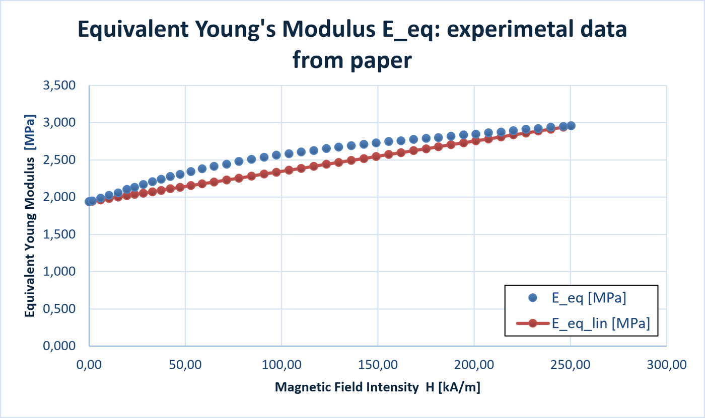 | 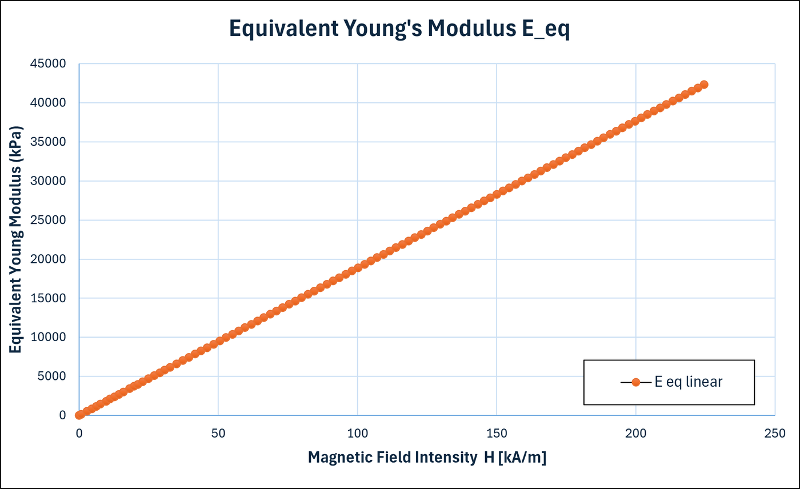 |

---

## 4. Thermoplastic Polyurethane (TPU)

| Property | Symbol | Value |
|---|:---:|:---:|
| Density | $`\rho`$ | 1200 kg/m³ |
| Young's modulus | $`E_{TPU}`$ | 7.5 MPa |
| Poisson's ratio | $`\nu`$ | 0.45 |
| Relative magnetic permeability | $`\mu_r`$ | 1 |
| Relative electric permittivity | $`\epsilon_r`$ | 1 |

---

## 5. Beam Design & Buckling Analysis

<p align="center">
  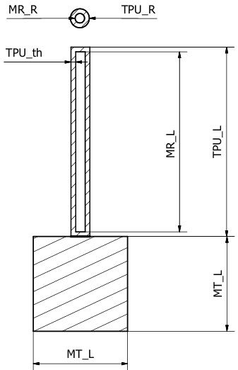
</p>

The metamaterial cell is a **hollow cylindrical TPU beam** (outer radius $`TPU_R`$, wall thickness $`TPU_{th}`$, length $`TPU_L`$). Its cavity (radius $`MR_R`$, length $`MR_L`$) is filled with MRF, and a **permanent magnet** of side $`MT_L = 20`$ mm sits underneath.

### 5.1 Buckling-free sizing

The beam is compressed with an imposed displacement $`u`$. To keep the study in the **linear regime**, buckling must not occur. The beam is treated as solid TPU with **fixed–fixed** ends (effective length factor $`k = 0.5`$):

```math
u = 0.1\,TPU_L, \qquad
P = \frac{E A}{TPU_L}\,u = 0.1\,E A, \qquad
P_{cr} = \frac{\pi^2 E I}{(k\,TPU_L)^2}, \qquad
I = \frac{\pi\,TPU_R^4}{4}
```

Setting $`P \le P_{cr}`$ gives the critical slenderness:

```math
TPU_L = \sqrt{\frac{\pi^2\,TPU_R^2}{4\,k^2\cdot 0.1}} \approx 9.95\,TPU_R
```

### 5.2 Single-parameter parametrisation

Every dimension is tied to $`TPU_L`$, so the geometry can be swept with one parameter and still stay buckling-safe:

```math
TPU_R = \frac{TPU_L}{9.95}, \quad
TPU_{th} = 0.05\,TPU_L, \quad
MR_L = TPU_L - TPU_{th}, \quad
MR_R = TPU_R - TPU_{th}
```

---

## 6. Multiphysics Simulation Setup (COMSOL)

**Physics modules:** *Solid Mechanics* and *Magnetic Fields, No Currents*.

### 6.1 Quasi-static compression with a smooth start

A smooth ramp avoids an infinite initial acceleration: constant acceleration up to $`v_{comp}`$, then constant velocity:

```math
t_{tot} = t_{smooth} + t_{cruise}, \qquad
t_{cruise} = \frac{u}{v_{comp}}, \qquad
t_{smooth} = 0.1\,t_{cruise}
```

```math
pw(t) =
\begin{cases}
\dfrac{v_{comp}\,t^2}{2\,t_{smooth}}, & 0 \le t \le t_{smooth} \\[2ex]
v_{comp}\left(t - \dfrac{t_{smooth}}{2}\right), & t > t_{smooth}
\end{cases}
```

The compression speed was chosen so that the **kinetic energy stays at least one order of magnitude below the elastic strain energy**, which keeps the quasi-static assumption valid. The result is $`v_{comp} = 50`$ mm/s, with $`t_{tot}`$ discretised in 100 steps.

| Smooth displacement $`pw(t)`$ | Kinetic vs elastic energy |
|:---:|:---:|
| 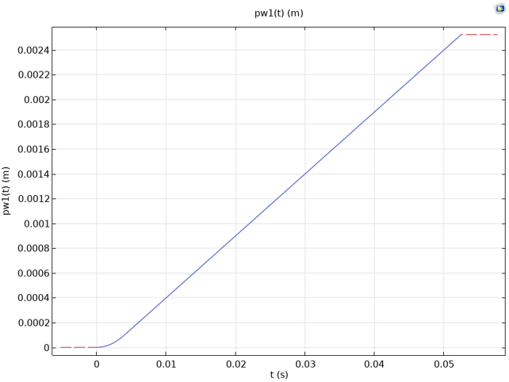 | 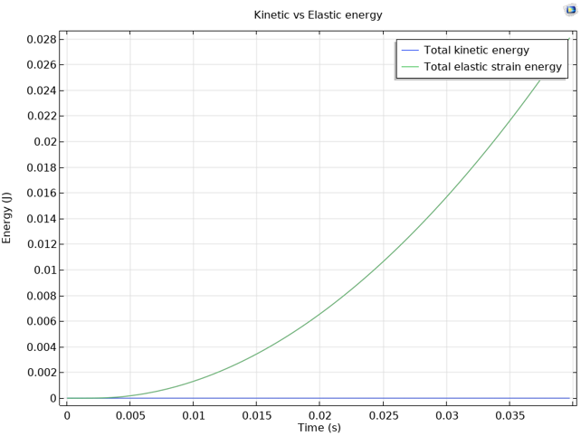 |

### 6.2 Geometry, boundary conditions, mesh, solver

<p align="center">
  
</p>

- **Air domain:** a cylinder with $`Air_L = 90`$ mm (height = diameter), needed for the magnetic field to develop correctly.
- **BCs:** fixed constraint at the base. On the top face, zero prescribed displacement in X and Y, and $`pw(t)`$ in Z.
- **Mesh:** physics-controlled, *Finer*. Refining it further changed nothing noticeable. A **moving mesh** on the air domain prevents element inversion (null or negative Jacobians).
- **Solver:** fully coupled with the **MUMPS** direct solver.

**Nominal stress and strain** used throughout:

```math
\sigma = \frac{|F_{Z,\text{reaction}}|}{\pi\,TPU_R^2}, \qquad \epsilon = \frac{u}{TPU_L}
```

---

## 7. Simulation Results

The model was built up **one layer of complexity at a time**, so each layer's effect could be isolated and checked.

### 7.1 3D vs 2D axisymmetric

The 2D axisymmetric model is much cheaper but cannot capture buckling. Comparing it with the full 3D model led to a reduced stroke, $`u = 0.05\,TPU_L`$, which is needed once the beam is hollow. With that stroke, **2D and 3D curves overlap exactly**, so the 2D model was used for dataset generation.

| Solid TPU beam | TPU walls + stiff core ($`E_{int} = 30`$ MPa) |
|:---:|:---:|
| 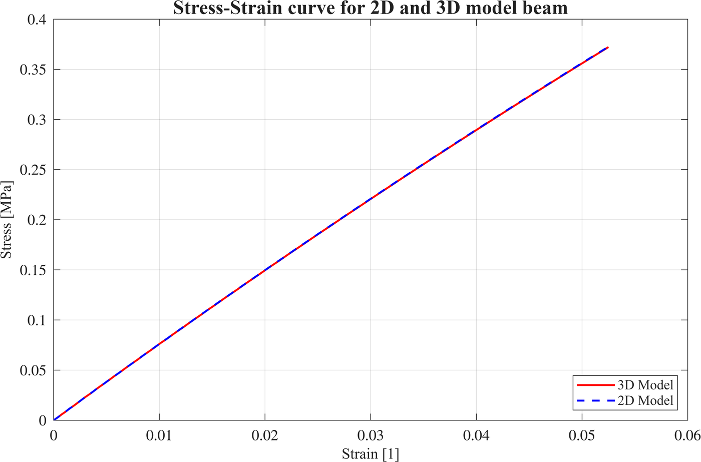 | 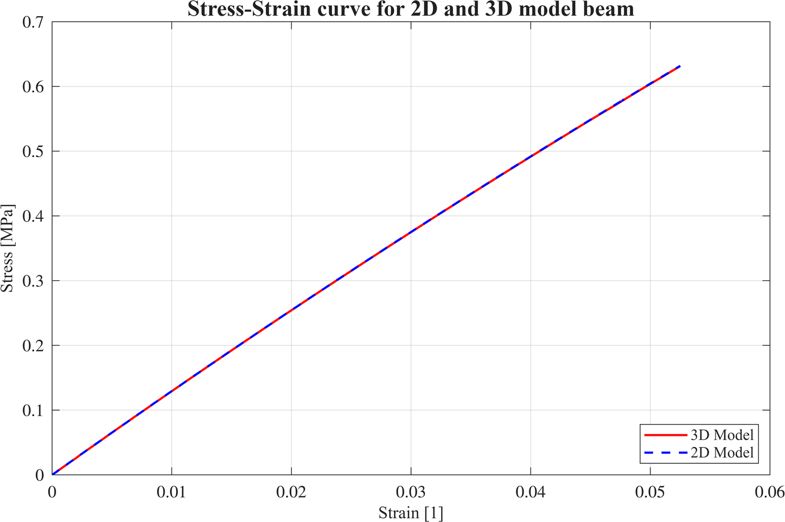 |
| Peak stress ≈ 0.37 MPa | Peak stress ≈ 0.62 MPa |

### 7.2 Solid mechanics with an imposed field

The MRF is modelled only through $`E_{eq}(H)`$, with $`H`$ swept as a parameter. Higher $`H`$ gives a stiffer response.

<p align="center">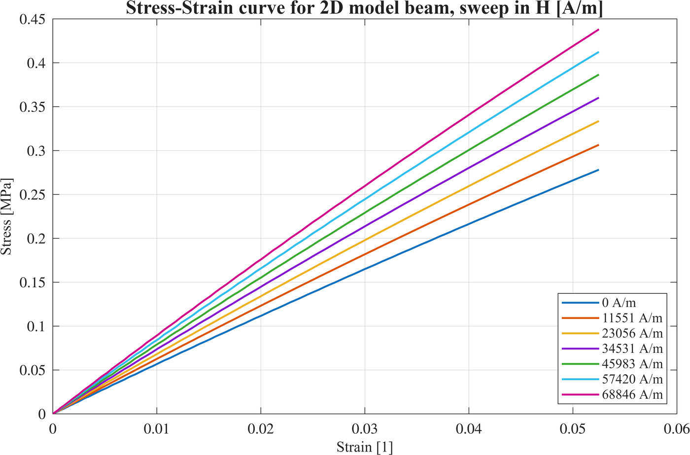</p>

### 7.3 Full multiphysics: magnet + MRF

The permanent magnet is modelled with a **remanent flux density** $`B`$, and the field it generates sets the local MRF stiffness.

<p align="center"></p>

| | Constant permeability ($`\mu_r = 6.5`$) | Non-linear $`B\text{–}H`$ curve |
|---|:---:|:---:|
| **Stress–strain** | 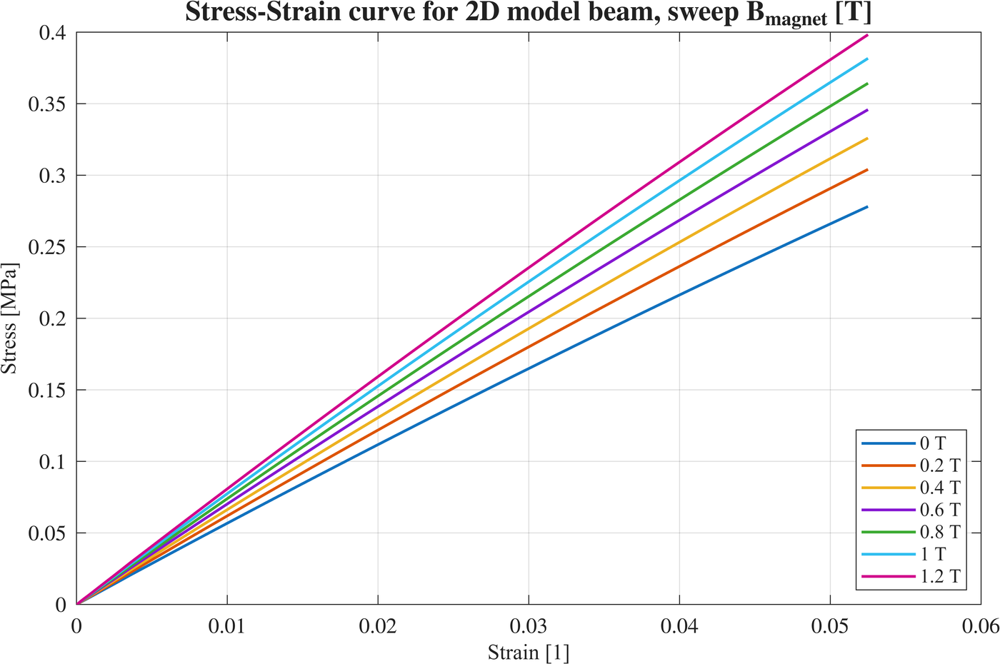 | 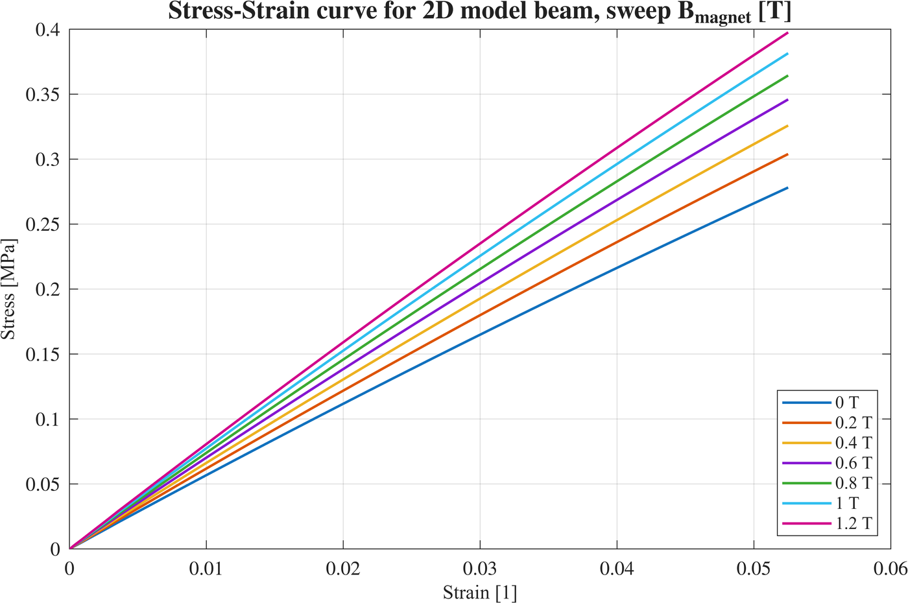 |
| **$`\lVert H\rVert`$ along the beam axis** | 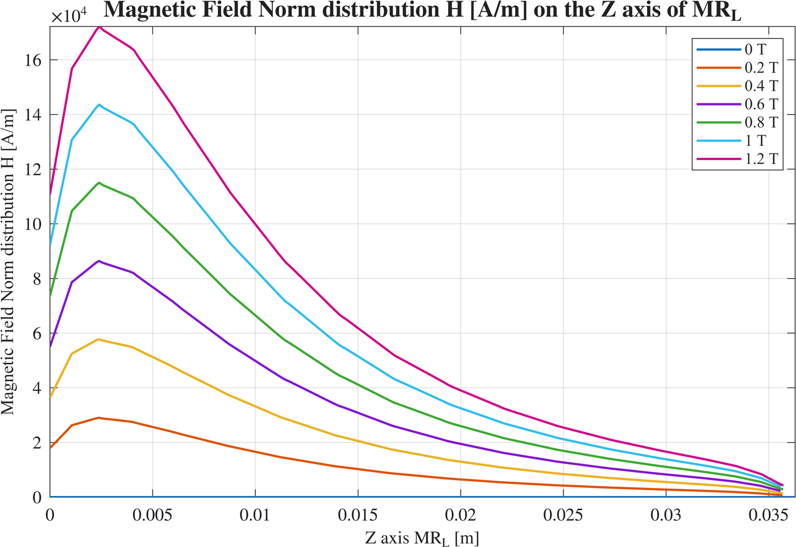 | 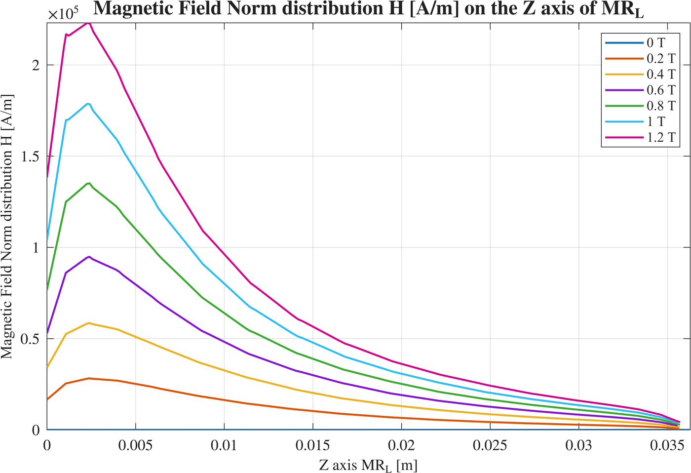 |

$`H`$ peaks close to the magnet and decays with a long tail along the axis.

### 7.4 Model comparisons

**Solid Mechanics vs Multiphysics.** The mean of each $`H(z)`$ distribution from the multiphysics model was fed into the pure solid-mechanics model:

<p align="center">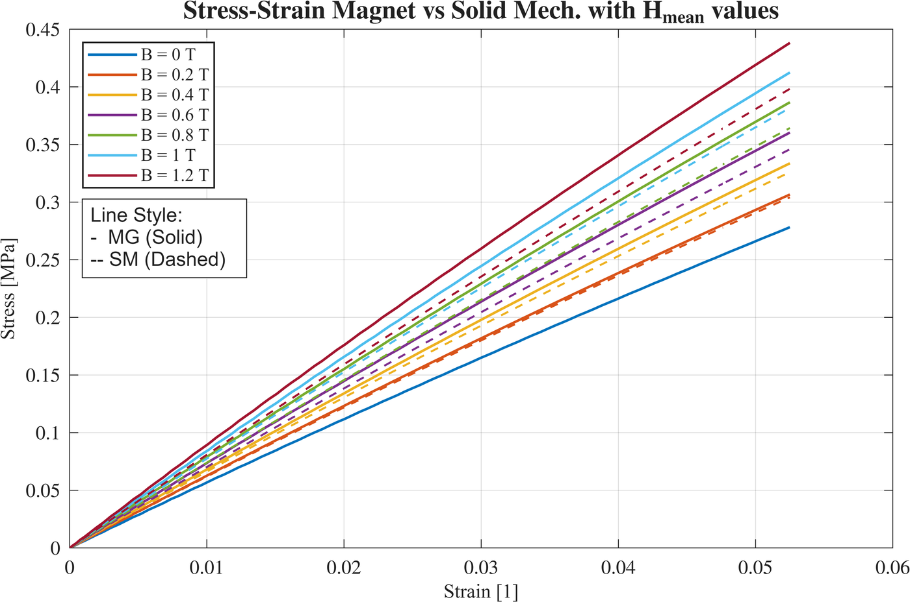</p>

**Effect of the $`B\text{–}H`$ curve.** Including it raises the $`H`$ peaks by a few kA/m. The global stress–strain response barely changes, but the spatial field distribution changes noticeably at high $`B`$:

| $`H(z)`$, with and without B–H | Stress–strain | Zoom |
|:---:|:---:|:---:|
| 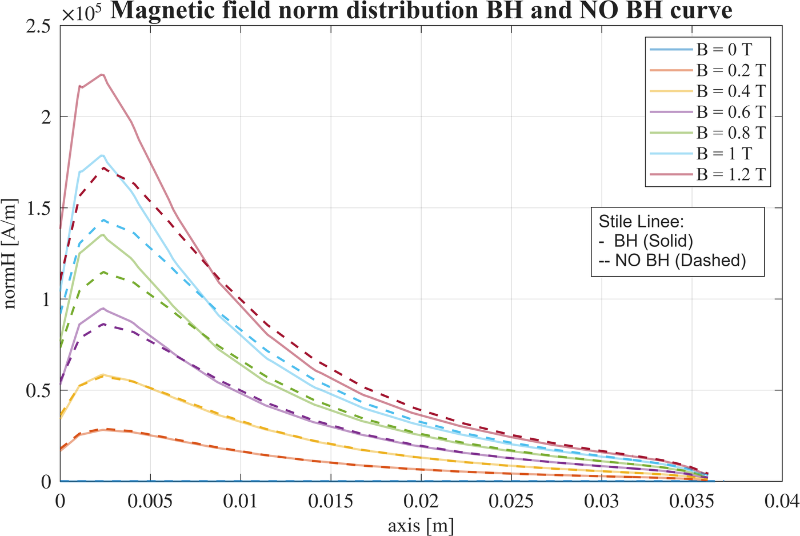 | 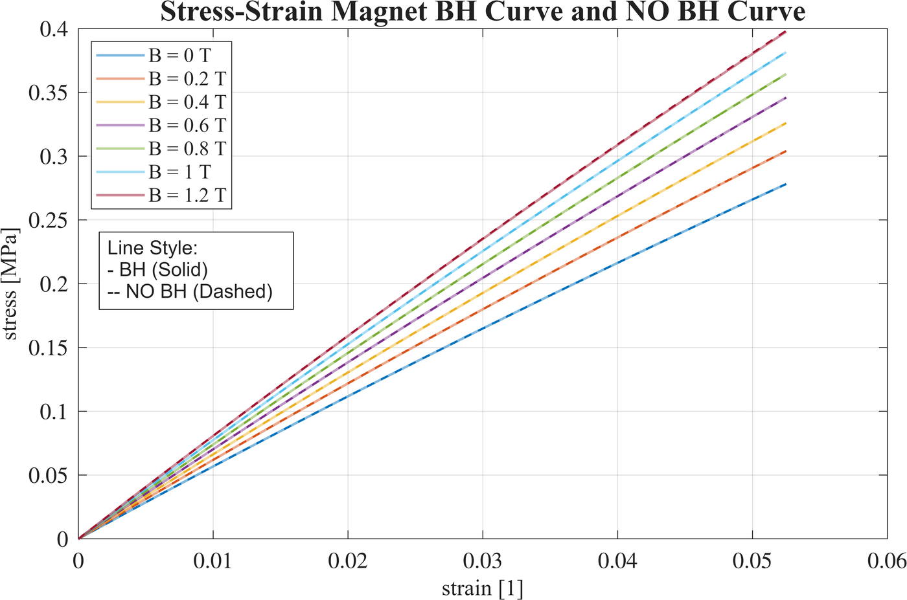 | 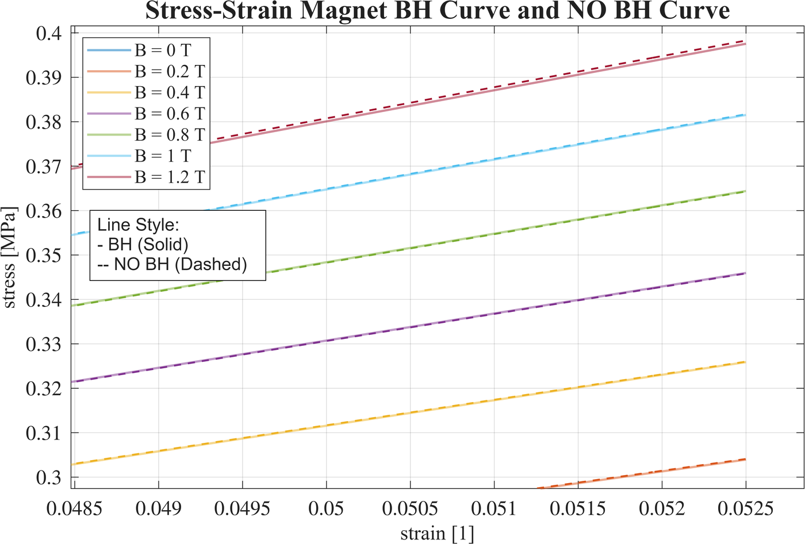 |

### 7.5 Decoupled simulation

The initial non-linear $`H(z)`$ was used to set a spatially varying modulus in a solid-mechanics-only model. This **underestimates the stiffness at high $`B`$**, because it misses the local field concentration that develops *during* compression. That is a clear argument for keeping the full coupling.

<p align="center">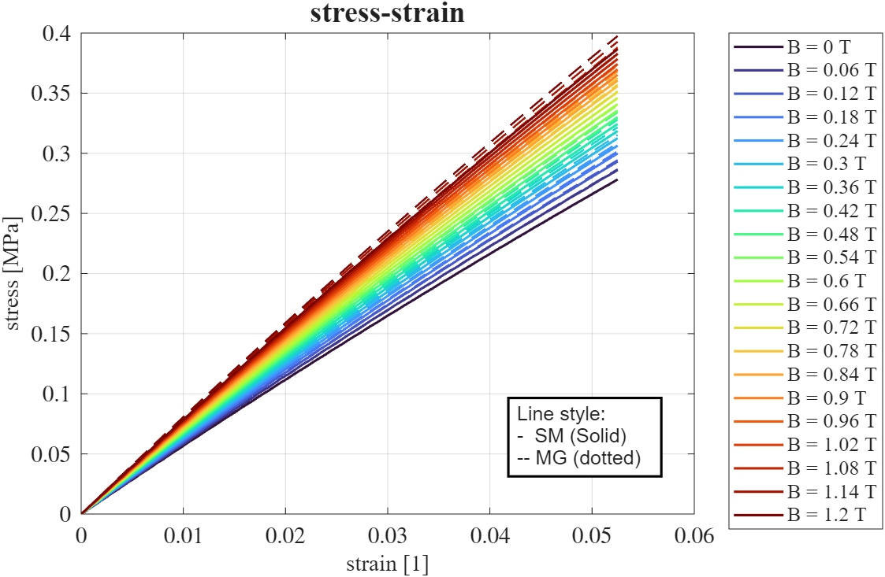</p>

---

## 8. Machine-Learning Digital Shadow

All surrogates are **multilayer perceptrons** implemented in **PyTorch**. Each neuron computes:

```math
y = \Phi\!\left(\sum_i w_i x_i + b\right)
```

They are trained with **MSE loss** and the **Adam** optimiser ($`\eta = 10^{-3}`$).

### 8.1 Dataset generation

The parametric sweep used the full multiphysics model (with the B–H curve):

| Parameter | Range | Steps |
|---|---|---|
| Beam length $`L = TPU_L`$ | 20 – 40 mm | 1 mm (M = 20) |
| Magnet flux density $`B`$ | 0 – 1.2 T | N = 20 |
| Time / strain history | $`t \in [0, t_{max}]`$ | $`N_t = 101`$ |

This gives about **400 simulations**. The $`B = 0`$ case (passive beam) was dropped from the sweep because it adds little information. A different dataset was extracted for each network:

```math
\begin{aligned}
S_{direct}  &= \Big\{ B_i,\ L_i,\ \{\epsilon_{i,j},\ \sigma_{i,j}\}_{j=1}^{N_t} \Big\}_{i=1}^{N_{sim}} \\
S_{inverse} &= \big\{ (B_i,\ L_i,\ \bar K_i) \big\}_{i=1}^{N_{sim}} \\
S_{field}   &= \big\{ (B_i,\ L_i,\ \mathbf{x}_i,\ B_i(\mathbf{x}_i),\ H_i(\mathbf{x}_i, t_0)) \big\}_{i=1}^{N_{sim}} \\
S_{\Delta H} &= \Big\{ B_i,\ L_i,\ \{\epsilon_{i,j}\}_{j=1}^{N_t},\ H_i(\mathbf{x}_i, t_0),\ \Delta H_i(\mathbf{x}_i) \Big\}_{i=1}^{N_{sim}}
\end{aligned}
```

### 8.2 Network overview

| Network | Mapping | Inputs | Hidden layers | Activation | Output |
|---|---|:---:|:---:|:---:|:---:|
| **Direct** | $`\sigma = f(B, L, \epsilon)`$ | 3 | 8 – 8 – 8 | ReLU | 1 |
| **Inverse** | $`L = f(B, \log\bar K)`$ | 2 | 8 – 8 – 8 | SiLU | 1 |
| **B(x)** | $`B(x) = f(B, x, L)`$ | 3 | 64 – 32 | ReLU | 1 |
| **H(x)** | $`H(x) = f(B, x, L)`$ | 3 | 64 – 32 | ReLU | 1 |
| **ΔH(x)** | $`\Delta H(\mathbf{x}) = f(B, H(\mathbf{x}), L, \epsilon)`$ | 67 | 256 – 128 | LeakyReLU | 64 |

### 8.3 Direct design network: $`\sigma = f(B, L, \epsilon)`$

A small 3×8 ReLU network, trained for 100 epochs.

| Dataset | RMSE | $`R^2`$ |
|---|:---:|:---:|
| Training | 0.00342 | 1.000 |
| Validation | 0.00346 | 1.000 |
| Test | 0.00346 | 1.000 |

<p align="center">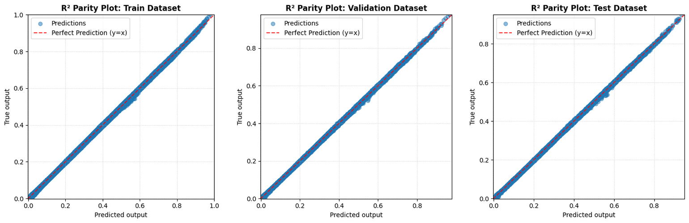</p>
<p align="center"><em>Normalised parity plots: training / validation / test.</em></p>

| Loss curves | Parity on test stress [MPa] |
|:---:|:---:|
| 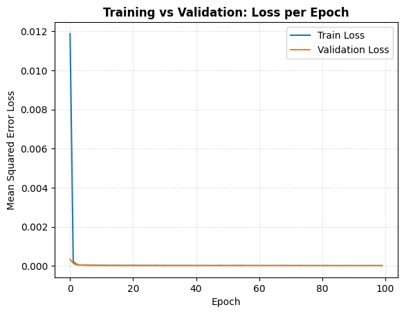 | 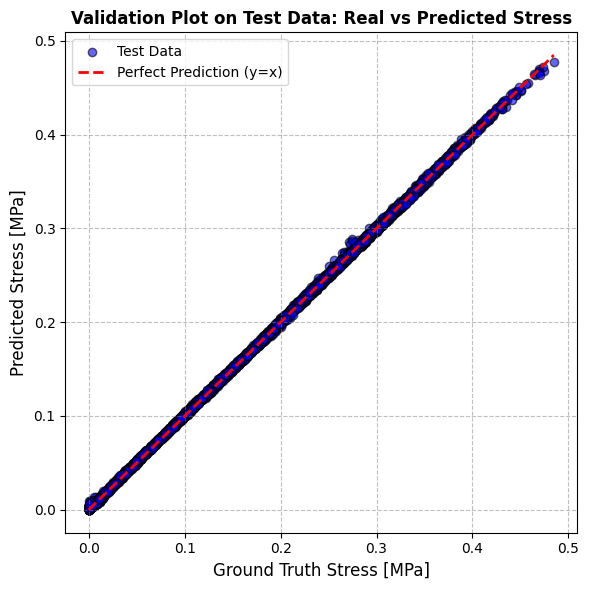 |

**Predicted vs FEM stress–strain curves** for a fixed geometry ($`L = 40`$ mm) and varying $`B`$:

<p align="center"></p>

The network matches the FEM curves closely for all active states ($`B > 0`$). The only noticeable deviation is the passive case $`B = 0`$, which is under-represented in the training set.

### 8.4 Inverse design network: $`L = f(B, \log\bar K)`$

Instead of raw curves, each simulation is reduced to a physically meaningful descriptor, the **mean stiffness** $`\bar K`$ of its σ–ε curve. A log transform handles its wide dynamic range.

| Dataset | RMSE | $`R^2`$ |
|---|:---:|:---:|
| Training | 0.0097 | 0.999 |
| Validation | 0.0102 | 0.999 |
| Test | 0.0101 | 0.999 |

<p align="center">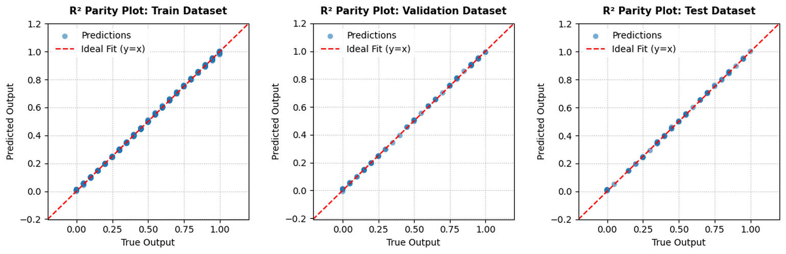</p>

| Loss curves | Relative error on the test set |
|:---:|:---:|
| 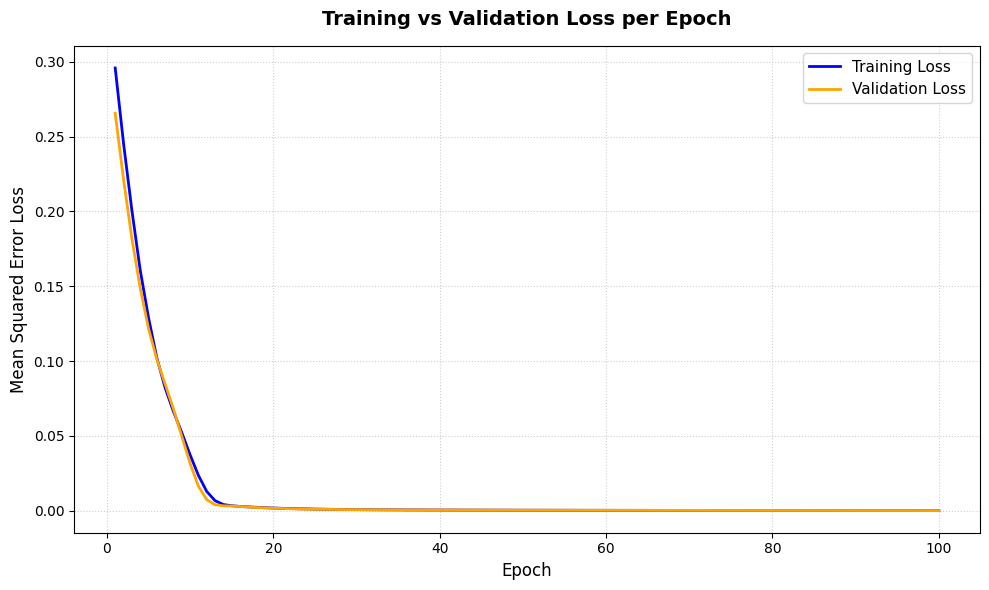 | 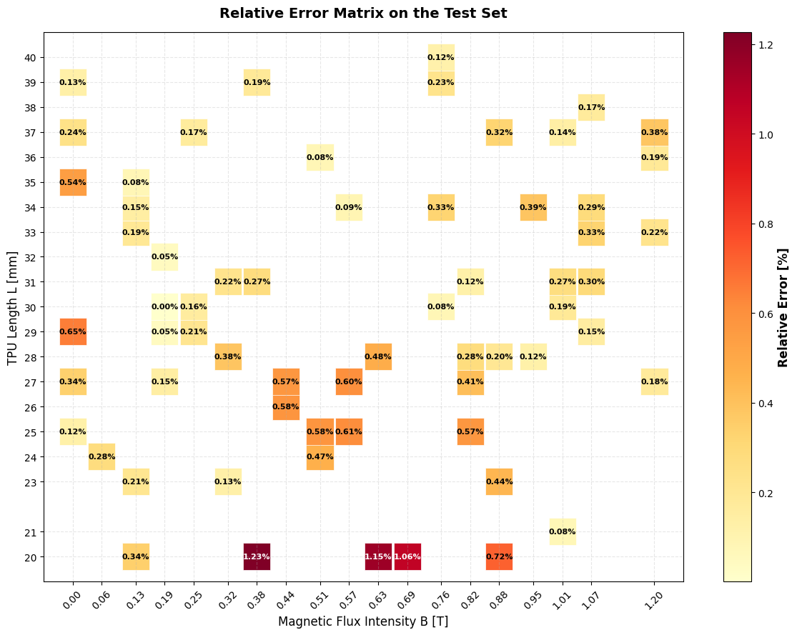 |

<p align="center">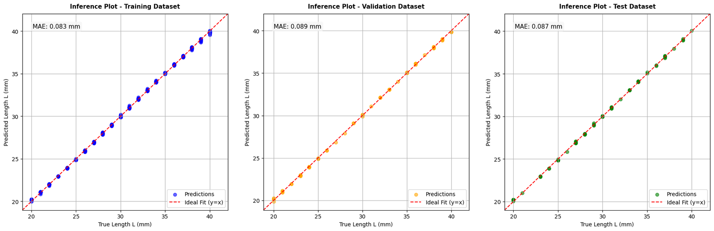</p>
<p align="center"><em>Predicted vs true beam length. MAE ≈ 0.08–0.09 mm on every split.</em></p>

The test-set relative error stays **below 1.25 %** across the whole $`(B, L)`$ grid. In practice, the network can tell you **which beam length to manufacture** to get a target stiffness under a given magnet.

### 8.5 Field networks: $`B(x)`$ and $`H(x)`$

These two networks predict the flux density and field intensity at any point along the beam axis, for any $`(B, L)`$ pair, including values outside the training grid.

| Predictions on unseen data (L = 42.5 mm) | Loss curves |
|:---:|:---:|
| 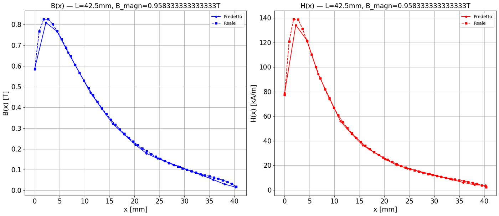 | 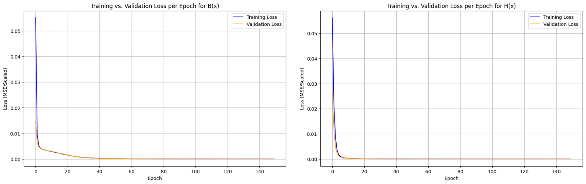 |

Most sample points lie in the decaying tail and only a few sit at the peak, so the local error is largest near the maximum.

### 8.6 Strain-induced field change: $`\Delta H(\mathbf{x})`$

Given the initial profile $`H(\mathbf{x}, t_0)`$, resampled to **64 points** with PCHIP interpolation to avoid oscillations, plus $`B`$, $`L`$ and the strain $`\epsilon`$, this network predicts the full 64-point change $`\Delta H(\mathbf{x})`$ caused by compression.

<p align="center">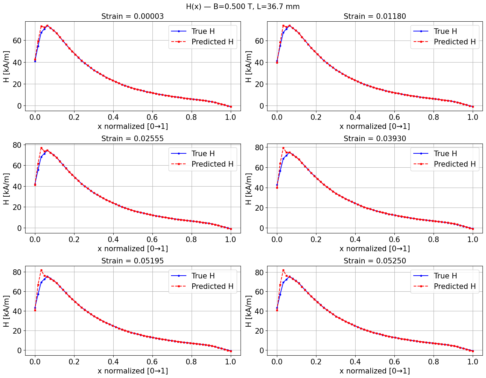</p>
<p align="center"><em>Reconstructed H(x) at increasing strain (B = 0.5 T, L = 36.7 mm). Error concentrates at the sharp rise before the peak.</em></p>

### 8.7 Cascaded digital shadow

The field networks are chained into a single **sequential pipeline**:

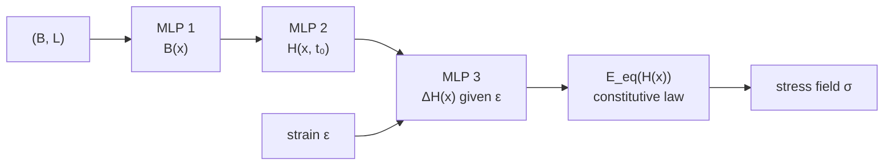

From the design parameters and the applied strain, the pipeline returns the full field $`H(\mathbf{x})`$. The local stiffness then follows directly from $`E_{eq\text{-}lin}(H)`$, and the stress field from that.

---

## 9. Results Summary

| Aspect | Outcome |
|---|---|
| MRF constitutive law | Linear $`E_{eq}(H) = 188.8\,H + q_\tau`$ kPa, from datasheet data |
| Beam sizing | Buckling-safe single-parameter geometry, $`TPU_L \approx 9.95\,TPU_R`$ |
| 2D vs 3D | Identical stress–strain response, so the 2D axisymmetric model was used for data generation |
| B–H non-linearity | Small effect on global stiffness, visible effect on the local $`H`$ distribution |
| Decoupled modelling | Unreliable at high $`B`$; full coupling needed |
| Direct surrogate | $`R^2 = 1.000`$, RMSE ≈ 3.5·10⁻³ |
| Inverse surrogate | $`R^2 = 0.999`$, relative error < 1.25 %, MAE ≈ 0.09 mm |
| Field surrogates | Accurate $`B(x)`$, $`H(x)`$, $`\Delta H(x)`$, chained into one digital shadow |

---

## 10. Limitations & Future Work

- **Experimental calibration:** the linear $`E_{eq}(H)`$ law comes from datasheet values and has **not been verified experimentally**. The next step is to characterise the MRF in squeeze mode and calibrate $`k`$ and $`\sigma_{min}`$.
- **Beyond linear elasticity:** the beam was deliberately sized to avoid buckling. **Using buckling on purpose** could add another design dimension, such as programmable snap-through.
- **End-to-end shadow:** the three field networks could be merged into **one end-to-end model** that predicts the full stress field directly from the design parameters.
- **Passive-state accuracy:** rebalancing the dataset, or weighting $`B = 0`$ samples more, would fix the direct model's bias toward active states.

---

## 11. References

1. J. D. Carlson, M. R. Jolly, "MR fluid, foam and elastomer devices," *Mechatronics*, 10(4–5), 555–569, 2000. [doi:10.1016/S0957-4158(99)00064-1](https://doi.org/10.1016/S0957-4158(99)00064-1)
2. S. A. Mazlan et al., "Compressive and tensile stresses of magnetorheological fluids in squeeze mode," *Int. J. Appl. Electromagn. Mech.*, 36(4), 327–337, 2011. [doi:10.3233/JAE-2011-1371](https://doi.org/10.3233/JAE-2011-1371)
3. M. R. Jolly, J. D. Carlson, B. C. Muñoz, "A model of the behaviour of magnetorheological materials," *Smart Mater. Struct.*, 5(5), 607–614, 1996. [doi:10.1088/0964-1726/5/5/001](https://doi.org/10.1088/0964-1726/5/5/001)
4. Arus MR Tech, "AMT-RHEOTEC+ Magnetorheological (MR) Fluid," product datasheet. [arusmrtech.com](https://www.arusmrtech.com)
5. J. A. Jackson et al., "Field responsive mechanical metamaterials," *Sci. Adv.*, 4(12), eaau6419, 2018. [doi:10.1126/sciadv.aau6419](https://doi.org/10.1126/sciadv.aau6419)
6. B. Marvalova, "Modelling of Magnetosensitive Elastomers," in *Modelling and Simulation*, I-Tech, 245–260, 2008.
7. S. Aghamiri, R. Sedaghati, "Magnetoactive Metamaterials: A State-of-the-Art Review," *Adv. Eng. Mater.*, 27, 2025. [doi:10.1002/adem.202501312](https://doi.org/10.1002/adem.202501312)
8. W. Zhang et al., "Magnetoactive microlattice metamaterials with highly tunable stiffness and fast response rate," *NPG Asia Materials*, 15, 45, 2023. [doi:10.1038/s41427-023-00492-x](https://doi.org/10.1038/s41427-023-00492-x)
9. P. Jiao et al., "Mechanical metamaterials and beyond," *Nature Communications*, 14, 6004, 2023.
10. D. Haid et al., "Mechanical metamaterials for sports helmets," *Smart Mater. Struct.*, 32(11), 113001, 2023. [doi:10.1088/1361-665X/acfddf](https://doi.org/10.1088/1361-665X/acfddf)
11. C. Lou et al., "Stiffness reprogrammable magnetorheological metamaterials inspired by spine…," *Sci. Adv.*, 11(41), eady8430, 2025. [doi:10.1126/sciadv.ady8430](https://doi.org/10.1126/sciadv.ady8430)
12. M. K. Thakur, C. Sarkar, "Development and performance analysis of a Magnetorheological fluid Clutch," preprint.
13. R. Lippmann, "An introduction to computing with neural nets," *IEEE ASSP Magazine*, 4(2), 4–22, 1987.

---

<p align="center"><sub>Group project for 063123 – Mechanical Engineering Applications of Deep Learning · Politecnico di Milano · A.Y. 2025/26</sub></p>
